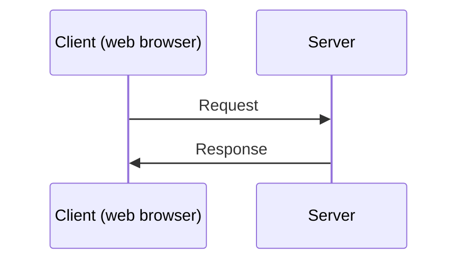

# Dynamic Web Apps

## Flask, Python, HTTP Requests and responses

<div class="attribution">

Adapted from *Dynamic web applications* © State of Victoria (Department of Education) 2026, licensed under [CC BY 4.0](https://creativecommons.org/licenses/by/4.0/). Changes were made.

</div>

---
layout: two-cols-header
---

# Reminder: HTML Tags

Identify the HTML tags that match with the descriptions

::left::

- A main heading
- A paragraph
- A link
- An image

::right::

- `<p>`
- `<a>`
- `<h1>`
- ``

<v-click>

**Answer:** main heading – `<h1>`, paragraph – `<p>`, link – `<a>`, image – ``

</v-click>

---
layout: center
---

# Learning objective

We are learning how dynamic web applications differ from static web pages.

---
layout: center
---

# Success criteria

- I can describe differences between static web pages and web applications.
- I can identify how web browsers and servers interact when accessing web content.
- I can display a message on a web page using Flask.

---
layout: center
---

# Vocabulary: Client

One that **asks for** a service or information to complete a task.

At a café, the customer is acting as the client as they request the service by ordering coffee.

**Synonym:** customer

---
layout: center
---

# Vocabulary: Server

One that **provides** a service, resource or information.

At a café, the barista is acting as the server as they provide the service by making the coffee and giving it to the customer.

**Synonym:** provider

---
layout: center
---

# Check for understanding

At a pharmacy, a customer asks for medicine and the pharmacist gives it to them.

- Who is the **client**?
- Who is the **server**?

<v-click>

**Answer:** The customer is the client; the pharmacist is the server.

</v-click>

---
layout: two-cols-header
---

# Static website vs. dynamic web app

::left::

## Static

- The page content is always the same every time a user visits.
- Like a printed poster — everyone sees the same thing.
- **Examples:** a personal portfolio, a restaurant's opening hours page.

::right::

## Dynamic

- The page content can change depending on user input or data.
- Like a conversation — the response depends on what you ask.
- **Examples:** search results, your YouTube home page, online banking.

---
layout: center
---

# Client-server communication



- A **client** is a device or app that asks for a service or information so it can do something (e.g. web browser).
- A **server** is a computer or program that provides a service or information when a client requests it.

---
layout: center
---

# Check for understanding

Complete the sentences.

- The browser is the ______ that asks for a webpage.
- The server is the ______ that finds the webpage and sends it back.

<v-click>

**Answer:** client, server

</v-click>

---
layout: center
---

# Flask web app

**Flask** is a Python package that lets your computer act like a web server.

A Flask web app:

1. waits for a request from a web browser.
2. decides what to do based on the URL.
3. sends a response back to the browser.

---
layout: two-cols
---

# Sample Flask app


```python {all|1|3|5|6-7|9-10}
from flask import Flask

app = Flask(__name__)

@app.route('/')
def index():
    return "Hello World!"

if __name__ == '__main__':
    app.run()
```

Open `http://127.0.0.1:5000` in the browser to see: **Hello World!**

<div v-click="1">

**Line 1:** Import the `Flask` class from the `flask` package. This is boilerplate code – it is always required in every Flask app.

</div>

::right::


<div v-click="2">

**Line 3:** Create an instance of the `Flask` class to initialise the Flask web app.

</div>

<div v-click="3">

**Line 5:** The route decorator connects a web address to a Python function. `/` is the root URL (homepage). When the browser requests that URL, Flask runs the function below it.

</div>

<div v-click="4">

**Lines 6-7:** This function runs when the URL is requested. It returns the string `"Hello World!"` and sends it to the browser as a response.

</div>

<div v-click="5">

**Lines 9-10:** This tells the app to run until manually quit (Red stop button or `Ctrl + F2` in Thonny).

</div>

---
layout: two-cols-header
---

# Check for understanding

::left::

```python
from flask import Flask

app = Flask(__name__)

@app.route('/')
def index():
    return "Hello World!"

if __name__ == '__main__':
    app.run()
```

::right::

1. What is the purpose of `@app.route('/')`?

<v-click>

**Answer:** It tells Flask to run the function below this code when a browser requests the homepage (`/`).

</v-click>

2. When the `index()` function runs, what response is sent back to the browser?

<v-click>

**Answer:** `Hello World!`

</v-click>

---
layout: two-cols-header
---

# Try it together

::left::

1. Install the **Thonny** IDE on your computer.
2. Go to the **Tools** menu and select **Manage packages**. Search for **Flask** and install it.
3. Open the `app.py` file in Thonny.
4. Run the `app.py` code (Green button or `F5` in Thonny)
5. Open `http://127.0.0.1:5000` in your browser (the address is also shown in Thonny's **Shell** panel).
6. Add comments to the code describing the purpose of each line.

::right::

```python
from flask import Flask

app = Flask(__name__)

@app.route('/')
def index():
    return "Coding is fun!"

if __name__ == '__main__':
    app.run(debug=True)
```

---
layout: center
---

# Review: Success criteria

- I can describe differences between static web pages and web applications.
- I can identify how web browsers and servers interact when accessing web content.
- I can display a message on a web page using Flask.

---
layout: center
---

# Exit ticket

Are these an example of static websites or dynamic applications? Write **S** for static and **D** for dynamic using mini-whiteboards.

1. The page content can change depending on user input or data. <span v-click>**D**</span>
2. The page content is always the same every time a user visits. <span v-click>**S**</span>
