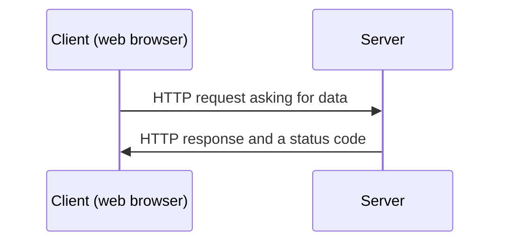

# HTTP Requests and Responses

## Python web apps: Lesson 2

<div class="attribution">

Adapted from *HTTP requests and responses* © State of Victoria (Department of Education) 2026, licensed under [CC BY 4.0](https://creativecommons.org/licenses/by/4.0/). Changes were made.

</div>

---
layout: center
---

# Retrieval practice: Pair-Share

What is the role of the **web browser** and **web server** in a dynamic web app?

<v-click>

**Answer:** The web browser (client) sends a request for a page. The web server receives the request, decides what to do, and sends a response back to the browser.

</v-click>

---
layout: center
---

# Learning objective

We are learning about HTTP requests and responses in web applications.

---
layout: center
---

# Success criteria

- I can describe the role of HTTP requests, responses and response codes in web communication.
- I can create Flask applications that use URL parameters to generate dynamic content.
- I can troubleshoot 500 Internal Server Errors using server traceback messages.

---
layout: center
---

# Vocabulary: Parameter

Information given to help decide how to act or what result to produce.

**Example:** The teacher set the parameters for the project, such as the word limit and deadline.

**Synonyms:** condition, rule, setting

---
layout: center
---

# Check for understanding

Find a parameter in this scenario:

> Students must submit a presentation that is 3-5 minutes long.

<v-click>

**Answer:** The length of the presentation – **3-5 minutes long**.

</v-click>

---
layout: center
---

# Vocabulary: Request

When someone asks for something to be given, done, or provided. A request is a message asking another person or system to respond.

**Example:** She made a request for help when she could not find the information she needed.

**Synonyms:** ask, enquire

---
layout: center
---

# Vocabulary: Response

The reply or reaction that happens after someone makes a request or asks a question. A response is the answer that is given back.

**Example:** The company sent a quick response to the customer's question.

**Synonyms:** reply, answer, react

---
layout: center
---

# Check for understanding

Identify the request and response in this scenario:

> In a restaurant, a customer asks for a glass of water and the waiter brings it.

<v-click>

- **Request:** the customer asks for a glass of water.
- **Response:** the waiter brings it.

*Reminder: the customer is acting as the **client** and the waiter is acting as the **server** in this scenario.*

</v-click>

---
layout: center
---

# Hypertext Transfer Protocol (HTTP)

Browser-server communication



---
layout: center
---

# Status codes

| Code    | Meaning               | Description                                                                         |
| ------- | --------------------- | ----------------------------------------------------------------------------------- |
| **200** | OK                    | Request was successfully processed.                                                 |
| **404** | Not found             | Client communicated with the server, but the server could not find what was requested. |
| **500** | Internal server error | Server met a condition that prevented it from completing the request.               |

<v-click>

- **4xx** codes mean a problem with the client's request. **5xx** codes mean a problem on the server. **2xx** codes mean the request was successful.
- In Flask, if the Python code in your function causes an error, the server sends back a **500**.

</v-click>

---
layout: center
---

# Check for understanding

Which status code will a server send back if you click a webpage link that was deleted last week?

<v-click>

**Answer:** **404** – Not found

</v-click>

---
layout: center
---

# Anatomy of a URL

The browser uses the URL to build the HTTP request it sends to the server.

<div class="text-3xl font-mono my-8">

<span class="text-blue-500">http://</span><span class="text-green-500">127.0.0.1</span>:<span class="text-orange-500">5000</span><span class="text-purple-500">/profile/</span><span class="text-red-500">Charlie</span>

</div>

- <span class="text-blue-500">**Protocol**</span> – `http://`
- <span class="text-green-500">**Host**</span> – `127.0.0.1` (your own computer)
- <span class="text-orange-500">**Port**</span> – `5000`
- <span class="text-purple-500">**Path (fixed part)**</span> – `/profile/`
- <span class="text-red-500">**Path parameter (variable part of the path)**</span> – `Charlie`

<v-click> 

> **Note:** The fixed part and variable part of the path are decided based on the route you define - these could be in any order and could have multiple variable parts. 

</v-click>

---
layout: center
---

# Flask route for a dynamic profile page

```python {all|5-7}
from flask import Flask

app = Flask(__name__)

# Define the route for the profile page with the username path parameter
@app.route('/profile/<username>')
def show_profile(username):
    return f"Welcome to the profile page of {username}."

if __name__ == '__main__':
    app.run()
```

<v-click>

Visiting `http://127.0.0.1:5000/profile/Charlie` shows: **Welcome to the profile page of Charlie.**

</v-click>

<v-click>

Flask passes `Charlie` into the function as `username`. The name inside `<username>` must **exactly match** the function's parameter name.

</v-click>

---
layout: center
---

# NameError example

```python {7}
from flask import Flask

app = Flask(__name__)

@app.route('/profile/<username>')
def show_profile(username):
    return f"Welcome to the profile page of {user}."

if __name__ == '__main__':
    app.run()
```

The browser shows a **500 Internal Server Error**. The traceback in Thonny's **Shell** panel tells you why:

```text
NameError: name 'user' is not defined
```

---
layout: two-cols
zoom: 1.05
---

# Flask route to double a number

```python {all|7|8|9}
from flask import Flask

app = Flask(__name__)

@app.route('/double/<number>')
def double(number):
    number = int(number)
    result = number * 2
    return f"Double of {number} is {result}."

if __name__ == '__main__':
    app.run(debug=True)
```

::right::

<div v-click="1">

**Line 7:** Convert string to integer.

</div>

<div v-click="2">

**Line 8:** Double the number.

</div>

<div v-click="3">

**Line 9:** Send result to browser.

</div>

---
layout: center
---

# What does `debug=True` do?

```python
app.run(debug=True)
```

Debug mode is a set of developer tools built into Flask:

- **Error pages with a traceback:** when your code causes an error, the browser shows the traceback, not just a plain "Internal Server Error" page. The server still sends a **500** status code.
- **Automatic reloading:** when you save changes to your code, the server restarts by itself.

Only use debug mode while developing. Never turn it on for a website the public can use, because the error pages show your code to anyone.

---
layout: center
---

# Logic error example

```python {7}
from flask import Flask

app = Flask(__name__)

@app.route('/double/<number>')
def double(number):
    result = number * 2
    return f"Double of {number} is {result}"

if __name__ == '__main__':
    app.run()
```

Visiting `http://127.0.0.1:5000/double/5` shows: **Double of 5 is 55**

<v-click>

Path parameters arrive as **strings**. `"5" * 2` repeats the string to make `"55"`, so there is no error and no traceback, just a wrong answer. 

We only find logic errors by testing the app and checking the output.

</v-click>

---
layout: center
---

# TypeError example

```python {7}
from flask import Flask

app = Flask(__name__)

@app.route('/double/<number>')
def double(number):
    result = number * 2.0
    return f"Double of {number} is {result}"

if __name__ == '__main__':
    app.run()
```

```text
TypeError: can't multiply sequence by non-int of type 'float'
```

A string can only be repeated a whole number of times, so this crashes and the server sends back a **500**. In both examples, the fix is to convert the parameter with `int()` first.

---
layout: center
---

# Errors from unexpected user input

A **500 Internal Server Error** can also happen when a user enters unexpected input.

`http://127.0.0.1:5000/double/two`

<v-click>

`int("two")` fails, so the server can't complete the request:

```text
ValueError: invalid literal for int() with base 10: 'two'
```

Because this app uses `debug=True`, the browser shows this traceback too, not a plain "Internal Server Error" page.

</v-click>

---
layout: center
---

# Preventing errors with input validation

```python {5}
from flask import Flask

app = Flask(__name__)

@app.route('/double/<int:number>')
def double(number):
    result = number * 2
    return f"Double of {number} is {result}"

if __name__ == '__main__':
    app.run()
```

`<int:number>` only accepts integers.

Visiting `http://127.0.0.1:5000/double/two` now returns **404 Page Not Found** instead of a 500 error.

---
layout: two-cols-header
---

# Try together

::left::

1. Create a new file in **Thonny** and copy in the code.
2. Save it as `app.py`.
3. Run the code (Green button or `F5` in Thonny).
4. Visit `http://127.0.0.1:5000/hours/90` in your browser.
5. Read the traceback in Thonny's **Shell** panel, then find and fix the error.
6. Stop the server (Red stop button or `Ctrl + F2` in Thonny) and run it again to test your fix.

::right::

```python
from flask import Flask

app = Flask(__name__)

# Define the route for converting minutes to hours
@app.route('/hours/<int:minutes>')
def hours(minutes):
    result = minutes / 60
    return f"{mins} min is {result} hr."

if __name__ == '__main__':
    app.run()
```

> If you are waiting for others to finish, modify the code to show hours and minutes instead of just hours - for example: `90 min is 1 hr and 30 min.`

---
layout: center
---

# Try together – corrected code

```python {9}
from flask import Flask

app = Flask(__name__)

# Define the route for converting minutes to hours
@app.route('/hours/<int:minutes>')
def hours(minutes):
    result = minutes / 60
    return f"{minutes} min is {result} hr."

if __name__ == '__main__':
    app.run()
```

`mins` was never defined, causing a `NameError`. It should be `minutes`.

---
layout: center
---

# Independent application

Complete activities from the **Lesson 2** section of the *Python web app workbook*.

Use **Thonny** to write and run your Flask apps. If you get a 500 error, check the traceback in Thonny's **Shell** panel.

>**Tip:** Rather than needing to rewrite the *bootstrap* code for every Flask app, you can create a copy of the hours coverter app and modify it for the new app. 
---
layout: center
---

# Review: Success criteria

- I can describe the role of HTTP requests, responses and response codes in web communication.
- I can create Flask applications that use URL parameters to generate dynamic content.
- I can troubleshoot 500 Internal Server Errors using server traceback messages.

---
layout: center
---

# Exit ticket

1. Fill the gaps: The browser sends an HTTP (a) <span v-click>**request**</span> to the server. The server processes it and sends back an HTTP (b) <span v-click>**response**</span>.
2. What is the role of HTTP response codes?
   
   a) They style the webpage for the browser.
   
   b) They tell the browser whether the request succeeded or failed. <span v-click>✅</span>
   
   c) They encrypt the data sent between client and server.
3. Your Flask app shows a 500 error. Where do you look to find out what went wrong? <span v-click>**Read the traceback message in the server terminal (Thonny's Shell panel).**</span>
