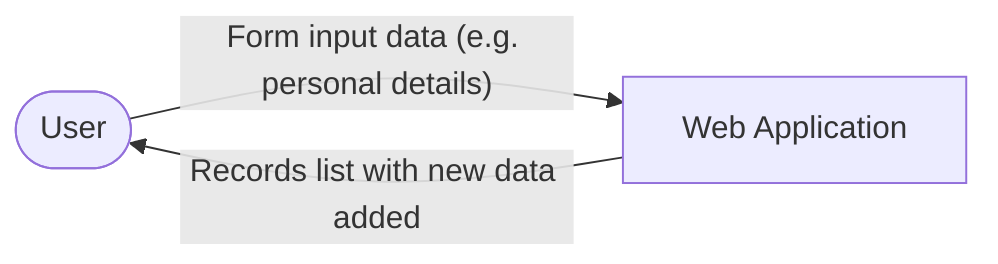
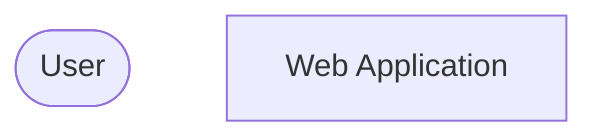
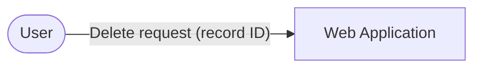

# Planning a Web App

## Python web apps: Lesson 7

<div class="attribution">

Adapted from *Planning a web app* © State of Victoria (Department of Education) 2026, licensed under [CC BY 4.0](https://creativecommons.org/licenses/by/4.0/). Changes were made.

</div>

---
layout: center
---

# Retrieval practice

On your mini-whiteboard, write down what the acronym **CRUD** stands for.

- C – <span v-click>**Create**</span>
- R – <span v-click>**Read**</span>
- U – <span v-click>**Update**</span>
- D – <span v-click>**Delete**</span>

---
layout: center
---

# Check for understanding

Provide a real-world example of the **Update** operation in a web application.

<v-click>

**Example answers:** changing your profile picture, editing a post, changing the quantity of an item in an online shopping cart.

</v-click>

---
layout: center
---

# Learning objective

We are learning to build a plan for our web app.

---
layout: center
---

# Success criteria

- I can create a project plan that breaks down tasks for designing, developing, testing and evaluating my web application.
- I can identify and create placeholder route functions for CRUD operations in Flask.
- I can document data flows using a system context diagram.

---
layout: center
---

# Vocabulary: Milestones

Important steps or achievements along the way.

**Synonyms:** important events, key stages, significant achievements, turning points

**Examples:**

- Graduating from school is a major milestone in life.
- Finishing my first project was an important milestone.

---
layout: center
---

# Check for understanding

**Pair-Share:** Think of an example of a milestone reached in a long-term school project.

<v-click>

**Example answers:** research completed, first draft submitted, prototype working, final presentation delivered.

</v-click>

---
layout: center
---

# Project planning

- Project planning is part of the **Analysis** phase of the problem-solving process.
- Doing analysis before development reduces errors later in the project.
- Visualising how data will flow through an application prevents structural problems later.

---
layout: center
---

# Tasks, subtasks and milestones

| Type          | What it is                                 | Example                   |
| ------------- | ------------------------------------------ | ------------------------- |
| **Task**      | A major piece of work in a phase of the project | Draft wireframes          |
| **Subtask**   | A smaller step that contributes to a task   | Sketch homepage layout    |
| **Milestone** | A zero-duration checkpoint marking completion | All wireframes finalised |

---
layout: center
---

# System context diagram: the Create operation

A system context diagram shows the data that flows between the user and the system.



---
layout: center
---

# Check for understanding

**Pair-Share:** Which direction should the arrow point for a *delete request (record ID)*?



<v-click>

**Answer:** from the **User** to the **Web Application** – the user sends the ID of the record to delete.



</v-click>

---
layout: center
---

# Placeholder routes

Developers use **placeholder route functions** that simply return a text string. They let you test the navigation structure before writing the full application logic.

```python
from flask import Flask

app = Flask(__name__)

# Placeholder: returns text until the real feature is built
@app.route("/add", methods=["GET", "POST"])
def add_record():
    return "Add Record not yet created"
```

Visit `http://127.0.0.1:5000/add` to check the route works.

---
layout: center
---

# Guided practice: Simple project plan

| Phase       | Task                    | Subtasks                                                 | Milestone                |
| ----------- | ----------------------- | -------------------------------------------------------- | ------------------------ |
| Analysis    | E.g. Create project plan | E.g. Clarify task list, identify subtasks, identify milestones | E.g. Project plan completed |
| Design      |                         |                                                          |                          |
| Development |                         |                                                          |                          |
| Evaluation  |                         |                                                          |                          |

<v-click>

<div class="text-sm">

**Example tasks:** Design – create mock-ups and test cases. Development – build and test each CRUD route. Evaluation – evaluate the app against the requirements.

</div>

</v-click>

---
layout: center
---

# Guided practice: Plan route URLs

| CRUD operation | Route URL                                   | HTTP methods                          |
| -------------- | ------------------------------------------- | ------------------------------------- |
| Create         | `/add`                                      | GET, POST                             |
| Read           | <span v-click="1">`/` and `/read/<id>`</span> | <span v-click="1">GET</span>          |
| Update         | <span v-click="2">`/edit/<id>`</span>         | <span v-click="2">GET, POST</span>    |
| Delete         | <span v-click="3">`/delete/<id>`</span>       | <span v-click="3">POST</span>         |

<v-click>

<div class="text-sm">

Create and Update need **GET** to show the form and **POST** to receive it. Delete only needs **POST** – a plain link uses GET, which makes it too easy to delete a record by accident.

</div>

</v-click>

---
layout: two-cols-header
zoom: 0.8
---

# Guided practice: Placeholder routes

::left::

```python
from flask import Flask

app = Flask(__name__)

@app.route("/")
def index():
    return "Home page not yet created"

@app.route("/add", methods=["GET", "POST"])
def add_record():
    return "Add Record not yet created"
```

::right::

```python
@app.route("/read/<record_id>")
def read_record(record_id):
    return "View Record not yet created"

@app.route("/edit/<record_id>", methods=["GET", "POST"])
def edit_record(record_id):
    return "Edit Record not yet created"

@app.route("/delete/<record_id>", methods=["POST"])
def delete_record(record_id):
    return "Delete Record not yet created"
```

<div class="text-sm">

Visiting `/delete/1` in the browser gives **405 Method Not Allowed** – that's correct, because delete only accepts POST.

</div>

---
layout: center
---

# Independent application: Project documentation and route placeholders

1. Open *Project Documentation*.
2. Formally document the project plan and data flows.
3. Create placeholder functions for each of your CRUD routes in **Thonny**, and test each one in the browser.

---
layout: center
---

# Review: Success criteria

- I can create a project plan that breaks down tasks for designing, developing, testing and evaluating my web application.
- I can identify and create placeholder route functions for CRUD operations in Flask.
- I can document data flows using a system context diagram.

---
layout: center
---

# Exit ticket: Write on a sticky note

List the placeholder routes you created today and state which CRUD operation each represents.

- C –
- R –
- U –
- D –
