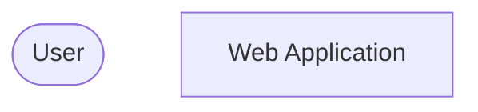
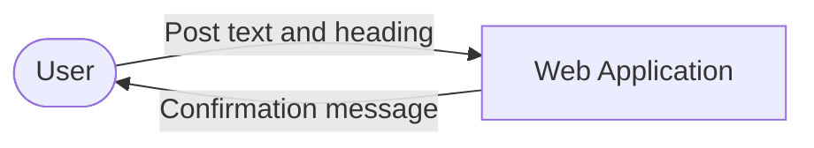

# Designing a Web App

## Python web apps: Lesson 8

<div class="attribution">

Adapted from *Designing a web app* © State of Victoria (Department of Education) 2026, licensed under [CC BY 4.0](https://creativecommons.org/licenses/by/4.0/). Changes were made.

</div>

---
layout: center
---

# Retrieval practice

Draw and label the missing data flows in the system context diagram for a user submitting a new post to a website.



<v-click>



</v-click>

---
layout: center
---

# Learning objective

We are designing the interface layout for our web app.

---
layout: center
---

# Success criteria

- I can create mock-ups to design my web application pages.
- I can build templates to meet user needs for my web application.
- I can represent the algorithm logic for each page using pseudocode.
- I can identify test cases for each page in my web application.

---
layout: center
---

# Vocabulary: Navigation

The process of finding your way from one place to another.

**Example:** Road signs and maps provide navigation for drivers travelling between towns.

**Synonyms:** directions, pathfinding

---
layout: center
---

# Bad navigation

**Pair-Share:** Think of an example of confusing navigation you have experienced in a digital system.

---
layout: center
---

# CRUD routes

CRUD stands for **Create, Read, Update** and **Delete**. Typical route names:

| Operation | Typical routes                                       |
| --------- | ---------------------------------------------------- |
| Create    | `/add` or `/create`                                  |
| Read      | `/` (home page summary) or `/read/<id>` (one record) |
| Update    | `/edit/<id>` or `/update/<id>`                       |
| Delete    | `/delete/<id>`                                       |

---
layout: two-cols-header
---

# User interface (UI) mock-ups

UI mock-ups act as a visual blueprint. They guide the creation of HTML templates and make sure all the input forms and data displays are accounted for.

::left::

<div class="border rounded text-sm mr-4">
<div class="border-b px-3 py-1 opacity-60 font-mono">myapp.com/add</div>
<div class="p-3">
<div class="font-semibold text-base mb-2">Add a new book</div>
<div>Title</div>
<div class="border rounded h-6 mb-2"></div>
<div>Author</div>
<div class="border rounded h-6 mb-2"></div>
<div>Year</div>
<div class="border rounded h-6 mb-3"></div>
<span class="border rounded px-2 py-1 mr-2">Add book</span>
<span class="border rounded px-2 py-1 opacity-60">Cancel</span>
</div>
</div>

::right::

Example UI mock-up: the **Add book** form (Create operation).

- Shows the URL the page lives at.
- Labels every input the user needs to fill in.
- Includes a way to cancel, so the user isn't stuck.

---
layout: center
---

# Pseudocode

Pseudocode is a way of writing the steps of an algorithm in plain English. It does not follow any programming language rules – it only needs to be clear and logical.

```text
BEGIN
  READ weather
  IF weather IS "raining" THEN
    PRINT "Take an umbrella"
  ELSE
    PRINT "No umbrella needed"
  END IF
END
```

---
layout: center
---

# Test cases

Define test cases during the **design** phase. This sets out exactly what conditions the application must pass to be considered successful.

| Test                               | Test data                                       | Expected result                                          | Actual result                                       |
| ---------------------------------- | ----------------------------------------------- | -------------------------------------------------------- | --------------------------------------------------- |
| Update record – edit existing data | Edit an existing record, change one field, click **Submit** | CSV is updated and the new value appears in the master view | CSV does not change: error. *(Retested after fix:)* as expected |

The **Actual result** column is filled in later, during testing.

---
layout: center
---

# Check for understanding

Describe a test case for a **Delete** function. Include the test data you would use and the expected result.

<v-click>

| Test                         | Test data                                        | Expected result                                                   |
| ---------------------------- | ------------------------------------------------ | ----------------------------------------------------------------- |
| Delete valid record          | Select a record and click **Delete**             | Confirmation message. Record no longer in the summary table.      |
| Try to delete invalid record | Send a delete request for ID 3000, which doesn't exist | Error message displayed. No change to the records in the summary table. |

</v-click>

---
layout: two-cols-header
zoom: 0.95
---

# From sketch to wireframe: View Records page

Start with a rough sketch to decide the layout. Then turn it into a labelled wireframe, ready to build as an HTML template.

::left::

**1. Sketch** – rough boxes, just to test the layout.

<div class="border border-dashed rounded p-3 mr-4 text-sm opacity-80">
<div class="flex justify-between mb-2"><span class="border border-dashed px-2">Page title</span><span class="border border-dashed px-2">nav</span></div>
<div class="border border-dashed px-2 mb-2 w-24">+ Add new</div>
<div class="grid grid-cols-3 gap-1">
<div class="border border-dashed px-1">Title</div><div class="border border-dashed px-1">Author</div><div class="border border-dashed px-1">Year</div>
<div class="border border-dashed px-1">...</div><div class="border border-dashed px-1">...</div><div class="border border-dashed px-1">...</div>
<div class="border border-dashed px-1">...</div><div class="border border-dashed px-1">...</div><div class="border border-dashed px-1">...</div>
</div>
</div>

::right::

**2. Wireframe** – labelled, ready to build as HTML.

<div class="border rounded p-3 text-sm">
<div class="flex justify-between mb-1"><span class="font-semibold">My Library</span><span>Home | About</span></div>
<div class="font-semibold mb-1">View Records</div>
<div class="border rounded px-2 mb-2 w-32">+ Add new book</div>
<table class="text-xs">
<thead>
<tr><th>Title</th><th>Author</th><th>Year</th></tr>
</thead>
<tbody>
<tr><td>The Hobbit</td><td>J.R.R. Tolkien</td><td>1937</td></tr>
<tr><td>Nineteen Eighty-Four</td><td>George Orwell</td><td>1949</td></tr>
<tr><td>Dune</td><td>Frank Herbert</td><td>1965</td></tr>
</tbody>
</table>
</div>

---
layout: center
---

# Guided practice: Write pseudocode for the Create function

Watch as the teacher writes pseudocode for a sample application's **Create** function.

```text
BEGIN
  READ form_data
  IF form_data.name EXISTS AND form_data.age > 10 THEN
    WRITE form_data to file
  ELSE
    DISPLAY error_message
  END IF
END
```

Modify the pseudocode to better explain how **your** function will decide what valid form data is.

---
layout: center
---

# Guided practice: Define test cases for your Create function

**Pair-Share** a second test table row for the Create function.

| Test                   | Test data               | Expected result                                       | Actual result           |
| ---------------------- | ----------------------- | ----------------------------------------------------- | ----------------------- |
| Submit valid form data | Name = "Alice", Age = 25 | Record added to CSV                                   | *[complete after testing]* |
| <span v-click>Submit invalid form data</span> | <span v-click="1">Name = "" (empty), Age = 25</span> | <span v-click="1">Error message displayed. No record added to CSV.</span> | <span v-click="1">*[complete after testing]*</span> |

<div class="text-sm opacity-75 mt-4">

Good test cases check **invalid** data too, not just the data you expect.

</div>

---
layout: center
---

# Review: Success criteria

- I can create mock-ups to design my web application pages.
- I can build templates to meet user needs for my web application.
- I can represent the algorithm logic for each page using pseudocode.
- I can identify test cases for each page in my web application.

---
layout: two-cols-header
---

# Exit ticket

::left::

1. Rewrite these pseudocode lines in the correct order, using indentation to show structure:

```text
END
IF form_data is valid THEN
BEGIN
END IF
APPEND form_data to file
READ form_data
```

2. Give one test case for a Create function: test data → expected result.

::right::

<v-click>

**Answers:**

```text
BEGIN
  READ form_data
  IF form_data is valid THEN
    APPEND form_data to file
  END IF
END
```

Test data: Name = "Alice", Age = 25 → Expected result: new row added to the CSV file.

</v-click>
