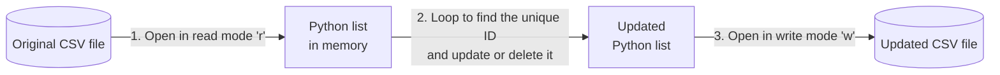

# Adding and Modifying Web App Records

## Python web apps: Lesson 10

<div class="attribution">

Adapted from *Adding and modifying web app records* © State of Victoria (Department of Education) 2026, licensed under [CC BY 4.0](https://creativecommons.org/licenses/by/4.0/). Changes were made.

</div>

---
layout: two-cols-header
---

# Retrieval practice

Which part of this template does each job?

::left::

```html
<!-- HTML template -->

  <tr>
    <td>{{ record.name }}</td>
    <td>
      <a href="/read/{{ record.id }}">View More</a>
    </td>
  </tr>

```

::right::

1. The route pointing to the detail view <span v-click>– `/read/`</span>
2. Creates the master summary list <span v-click>– the `` loop</span>
3. Passes the unique ID linking the two views <span v-click>– `{{ record.id }}`</span>

---
layout: center
---

# Learning objective

We are learning to create an interface to add, update and delete records in our web app.

---
layout: center
---

# Success criteria

- I can describe how UI elements, validation and clear communication reduce user input errors.
- I can implement create, update and delete functions that modify data in a CSV file.
- I can identify possible consequences of not implementing validation.

---
layout: center
---

# Vocabulary: Modify

Make a small change to improve or update something.

**Example:** After getting feedback from her teacher, Sarah had to modify her history essay before handing in the final copy.

**Synonyms:** change, update, adjust

---
layout: center
---

# Check for understanding

Which of the following is an example of **modifying**?

- A. Throwing a broken bike in the bin.
- B. Buying a brand new bike.
- C. Painting an old bike a new colour. <span v-click>✅</span>

---
layout: center
zoom: 0.9
---

# Choosing the right UI elements

```html
<form action="/edit/{{ record['id'] }}" method="POST">
  <label for="quantity">Quantity:</label>
  <!-- type="number" only allows numbers. min="1" stops zero and negatives.
       required stops empty data. -->
  <input type="number" name="quantity" id="quantity" min="1" required>

  <label for="state">State:</label>
  <!-- A drop-down <select> menu removes spelling errors entirely -->
  <select name="state" id="state" required>
    <!-- Clear prompt that tells the user what to do -->
    <option value="">Select a state...</option>
    <option value="VIC">Victoria</option>
    <option value="NSW">New South Wales</option>
  </select>

  <button type="submit">Update Record</button>
</form>
```

---
layout: center
---

# Check for understanding

**True or false?** Show thumbs up (true) or thumbs down (false).

> Using the right UI elements makes certain that the data we collect is always correct.

<v-click>

**False.** The right UI elements **reduce** errors, but a user can still choose the wrong option, and client-side checks can be bypassed. We still need server-side validation.

</v-click>

---
layout: center
---

# Modifying data in a CSV file

CSV files are plain text, so you can't change one row in place. Instead:



Write mode **wipes the old file** and completely overwrites it with the new list.

---
layout: center
zoom: 0.85
---

# Worked example: Deleting a record

```python {all|3-10|11-15|16}
@app.route("/delete/<record_id>", methods=["POST"])
def delete_record(record_id):
    updated_rows = []
    # STEP 1: read the file into a list, skipping the record to delete
    with open(FILENAME, mode="r", newline="") as file:
        reader = csv.DictReader(file)
        headers = reader.fieldnames  # Save the column names for later
        for row in reader:
            if row["id"] != record_id:  # Keep every row that doesn't match
                updated_rows.append(row)
    # STEP 2: open in write mode, which WIPES the old file clean
    with open(FILENAME, mode="w", newline="") as file:
        writer = csv.DictWriter(file, fieldnames=headers)
        writer.writeheader()  # Write the column names first
        writer.writerows(updated_rows)
    return redirect("/")
```

The `for` loop must stay **inside** the first `with` block – once the block ends, the file is closed and can't be read.

---
layout: center
---

# The delete button

Delete only accepts **POST**, so use a small form instead of a link. Add it to each row of `master.html`:

```html
<form action="/delete/{{ record['id'] }}" method="POST">
  <button type="submit">Delete</button>
</form>
```

<v-click>

Why not a plain link? Links send **GET** requests, and browsers or other tools can follow links automatically – which could delete records without anyone clicking.

</v-click>

---
layout: center
---

# Check for understanding

**True or false?** Show thumbs up (true) or thumbs down (false).

> If the unique ID passed from our HTML form does not exist anywhere in the CSV file, the Python script will crash and delete all of our data.

<v-click>

**False.** No row matches, so the loop keeps **every** row, and the file is rewritten unchanged.

</v-click>

---
layout: center
zoom: 0.8
---

# Worked example: Updating a record

```python {all|3-7|8-14|15-24|25-26}
@app.route("/edit/<record_id>", methods=["GET", "POST"])
def edit_record(record_id):
    # STEP 1: read every row into a list
    with open(FILENAME, mode="r", newline="") as file:
        reader = csv.DictReader(file)
        headers = reader.fieldnames
        rows = list(reader)
    # STEP 2: find the row with the matching ID
    record = None
    for row in rows:
        if row["id"] == record_id:
            record = row
    if record is None:
        abort(404)
    if request.method == "POST":
        # Changing record also changes that row in the rows list
        record["name"] = request.form.get("name", "").strip()
        record["email"] = request.form.get("email", "").strip()
        # STEP 3: overwrite the file with the updated list
        with open(FILENAME, mode="w", newline="") as file:
            writer = csv.DictWriter(file, fieldnames=headers)
            writer.writeheader()
            writer.writerows(rows)
        return redirect("/read/" + record_id)
    # GET: show the edit form, filled in with the current values
    return render_template("edit.html", record=record)
```

---
layout: center
---

# The edit form

**`templates/edit.html`** – the `value` attributes fill the form with the record's current details.

```html
<h1>Edit Student</h1>
<form action="/edit/{{ record['id'] }}" method="POST">
  <label for="name">Name</label>
  <input type="text" name="name" id="name" value="{{ record['name'] }}" required>
  <label for="email">Email</label>
  <input type="email" name="email" id="email" value="{{ record['email'] }}" required>
  <button type="submit">Save changes</button>
</form>
```

Add the server-side validation from Lesson 5 before saving, too.

---
layout: center
zoom: 0.9
---

# Worked example: Creating a record with a unique ID

A new record needs an ID that no other record has. One simple way is to use one more than the biggest existing ID.

```python {all|3-4|5-9|10-17}
@app.route("/add", methods=["POST"])
def add_record():
    with open(FILENAME, mode="r", newline="") as file:
        rows = list(csv.DictReader(file))
    # New ID is one more than the biggest existing ID
    new_id = 1
    for row in rows:
        if int(row["id"]) >= new_id:
            new_id = int(row["id"]) + 1
    new_record = {"id": new_id,
                  "name": request.form.get("name", "").strip(),
                  "year_level": request.form.get("year_level", "").strip(),
                  "email": request.form.get("email", "").strip()}
    # Append mode adds one row to the end of the file
    with open(FILENAME, mode="a", newline="") as file:
        writer = csv.DictWriter(file, fieldnames=["id", "name", "year_level", "email"])
        writer.writerow(new_record)
    return redirect("/")
```

---
layout: center
---

# Guided practice

Add **Create**, **Update** and **Delete** to your project in **Thonny**:

1. Add the `/add` route and a form to create a new record with a unique ID.
2. Add the `/edit/<record_id>` route and `edit.html`.
3. Add the `/delete/<record_id>` route and a delete button for each record.
4. Test each one in the browser, then open `data.csv` to check the file changed as expected.

---
layout: center
---

# Summary

- Use drop-down menus and `required` to stop bad data from crashing the app or breaking the data file.
- Add `placeholder` text to show users exactly how to format their answers.
- Because CSVs are simple text files, you must: 1) read all data into a list, 2) change the specific row, and 3) overwrite the entire file.
- Use **write mode** (`mode='w'`) when saving updates, to replace the old file with your new data.
- Always use a **unique identifier** to find the exact record you want to change, so you don't update or delete the wrong record.

---
layout: center
---

# Review: Success criteria

- I can describe how UI elements, validation and clear communication reduce user input errors.
- I can implement create, update and delete functions that modify data in a CSV file.
- I can identify possible consequences of not implementing validation.

---
layout: center
---

# Exit ticket

1. **True or false:** Drop-down menus reduce input errors compared to free text fields. <span v-click>**True** – they limit choices and prevent invalid input.</span>
2. **Fill in the blank:** To update a record, the CSV file is read into a ______, modified, then overwritten. <span v-click>**list**</span>
3. **Short answer:** What is one possible consequence of not validating user input? <span v-click>Incorrect or corrupted data, application errors or crashes, inaccurate records shown to users.</span>
