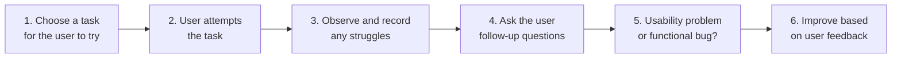

# Testing a Web App

## Python web apps: Lesson 11

Adapted from *Testing a web app* © State of Victoria (Department of Education) 2026, licensed under [CC BY 4.0](https://creativecommons.org/licenses/by/4.0/). The original resource was partially generated with the support of AI. Changes were made.

---
layout: center
---

# Retrieval practice

Match the strategy to the error.

1. A user submits a form with the status field left blank. → **A**
2. A user types letters into a field that expects a number. → **C**
3. A user bypasses the HTML form and sends malformed data directly to the server. → **B**

**Strategies:**

- A. Add the `required` attribute to the HTML input.
- B. Check for empty or invalid values in Python before writing to the CSV file.
- C. Restrict the input to valid options, e.g. a `<select>` drop-down or `type="number"`.

---
layout: center
---

# Learning objective

We are learning to respond to user testing in our web app.

---
layout: center
---

# Success criteria

- I can describe differences between functional bugs and usability problems.
- I can conduct usability testing and provide constructive feedback on a web application's user interface.
- I can respond to usability feedback and identify improvements for my web application.

---
layout: two-cols-header
---

# Usability problems vs functional bugs

::left::

## Usability problem

A flaw in your app's **design** that makes it confusing, frustrating or difficult for a person to use.

**Example:** the user can't find the **+ Add book** button.

::right::

## Functional bug

A mistake in your **code** that stops your app from working properly or causes it to crash.

**Example:** a user clicks a link to view their profile, but gets a **404 Not Found** error.

---
layout: center
---

# Usability testing vs functional testing

|                       | Usability testing                                   | Functional testing                  |
| --------------------- | --------------------------------------------------- | ----------------------------------- |
| **Goal**              | Ensure your app is easy for people to use and understand | Ensure your app works exactly as designed |
| **Focus**             | User behaviour                                      | System behaviour                    |
| **Who tests?**        | Real users                                          | Developer or tester                 |
| **Test outcome**      | Insights and design improvements                    | Pass/fail results                   |
| **Question answered** | 'Is it easy to use?'                                | 'Does it work?'                     |

---
layout: center
---

# Check for understanding

**Scenario:** A user completes the set task but takes a long time and appears confused throughout.

Would this be a usability problem or a functional bug?

<v-click>

**Usability problem** – the app worked, but it was hard to use.

</v-click>

---
layout: center
---

# How to conduct usability testing

**Example questions for step 4:**

- Which part was confusing or unclear?
- Was there any point where you weren't sure what to do next?

---
layout: center
---

# Giving constructive feedback as a user

Constructive feedback helps the developer improve the app without feeling criticised.

- ✅ **Example:** *"I wasn't sure what to click next because the button label was unclear. Maybe rename it to 'Add new record'."*
- ❌ **Non-example:** *"This is confusing. Your app is very bad."*

Good feedback says **what** happened, **why** it was a problem, and suggests **a fix**.

---
layout: center
---

# Example user testing

| Task                                      | User action or struggle observed       | Functional bug or usability problem? |
| ----------------------------------------- | -------------------------------------- | ------------------------------------ |
| 1. The user adds a new book to the book tracker app. | Has trouble finding the **+ Add book** button | Usability problem |
| 2. The user views the detail of a book.   | **500 Internal Server Error** message displayed | Functional bug |

---
layout: center
---

# Guided practice: Usability testing

**Task:** Add a new contact and edit the email address.

1. Observe and record the user's actions, hesitation or confusion, and unclear steps.
2. Ask the user follow-up questions to get feedback on usability.
3. Decide: usability problems or functional bugs?
4. Pick one change that directly addresses the issue and improves the app.

---
layout: center
---

# Common usability fixes

| Fix                         | Before         | After                          |
| --------------------------- | -------------- | ------------------------------ |
| 1. Add placeholder text     | Name `[      ]` | Name `[ Enter full name ]`     |
| 2. Use descriptive buttons  | `[ Submit ]`   | `[ Save Contact ]`             |
| 3. Highlight required fields | Email         | Email **\***                   |
| 4. Make actions obvious     | Click here     | `[ Get Started ]`              |

---
layout: center
---

# Independent application: Implement improvements

Identify and implement **at least two** interface or logic improvements in your Python or HTML files, based on the feedback you received.

Record each improvement and the feedback it responds to in your project documentation.

---
layout: center
---

# Review: Success criteria

- I can describe differences between functional bugs and usability problems.
- I can conduct usability testing and provide constructive feedback on a web application's user interface.
- I can respond to usability feedback and identify improvements for my web application.

---
layout: two-cols-header
---

# Exit ticket

::left::

**Q1.** When a page returns a **500 Internal Server Error**, this is an example of:

- A. A usability problem
- B. A functional bug ✅
- C. A design preference
- D. A navigation issue

::right::

**Q2.** During usability testing, the observer should:

- A. Tell the user where to click
- B. Fix the code while the user is testing
- C. Watch silently and record what the user does ✅
- D. Stop the test when the user gets stuck
